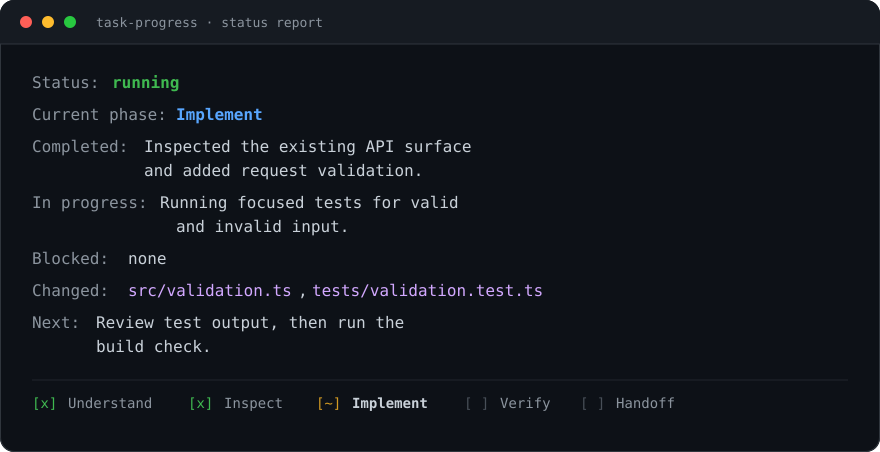

# Task Progress Skill

[](LICENSE)

A platform-neutral Agent Skill for making long-running AI work visible.

[简体中文](README.zh-CN.md) · [Skill instructions](SKILL.md) · [Examples](examples/status-report.md)




When an AI agent edits code, investigates a problem, or runs a multi-step workflow, users should be able to answer:

- What phase is the task in?
- What has been completed?
- What is happening now?
- Is anything blocked?
- Which files or artifacts changed?
- What happens next?

This skill defines a lightweight protocol for answering those questions accurately without pretending to provide runtime monitoring that the host does not expose.

## What it does

- Creates a short phase-based checklist for non-trivial work.
- Keeps one current phase visible and marks completed work promptly.
- Reports meaningful checkpoints instead of narrating every tool call.
- Uses a consistent status format on request or at important milestones.
- Surfaces blockers, changed files, verification results, and the next action.
- Supports an optional project-local status artifact for cross-session visibility.
- States the boundary between conversational transparency and real process monitoring.

## Install

Copy `SKILL.md` into the skill directory supported by your Agent host, or install it using that host's skill manager. The file follows the common Agent Skill format with YAML front matter containing `name` and `description`.

This repository does not assume Claude Code, Codex, Cursor, OpenAI Agents SDK, or any other specific host.

## Usage

The skill is intended to activate for long-running or multi-step work, and when a user asks for progress. A typical status report looks like this:

```text
Status: running
Current phase: Implement
Completed: Inspected the existing API and added the request validation path.
In progress: Running focused tests to verify accepted and rejected inputs.
Blocked: none
Changed: src/validation.ts, tests/validation.test.ts
Next: Review the test output and run the relevant build check.
```

For a larger task, the agent can also show:

```text
Progress
- [x] Understand request and constraints
- [x] Inspect relevant code or sources
- [~] Implement the agreed change
- [ ] Verify behavior
- [ ] Report result
```

## Durable status

The conversational report is the default. If a task spans sessions and the host permits project-local files, the agent may maintain one small artifact such as `.ai/task-progress.md` or `.ai/task-progress.json`. It should be updated at phase boundaries and must not contain secrets.

The artifact is optional because a skill cannot assume that every host supports filesystem access, background-job inspection, or shared state.

## Design limits

This is a transparency protocol, not a process monitor or tracing backend. It cannot reveal hidden tool activity, infer another agent's private state, or guarantee real-time updates. For external monitoring, use host-native logs, traces, job controls, or dashboards.

## Files

- `SKILL.md` - the reusable skill instructions.
- `examples/status-report.md` - copyable examples for common task states.
- `docs/preview.svg` - the status report illustration used above.
- `scripts/validate_skill.py` - dependency-free structure validation.

## License

MIT. See [LICENSE](LICENSE).
